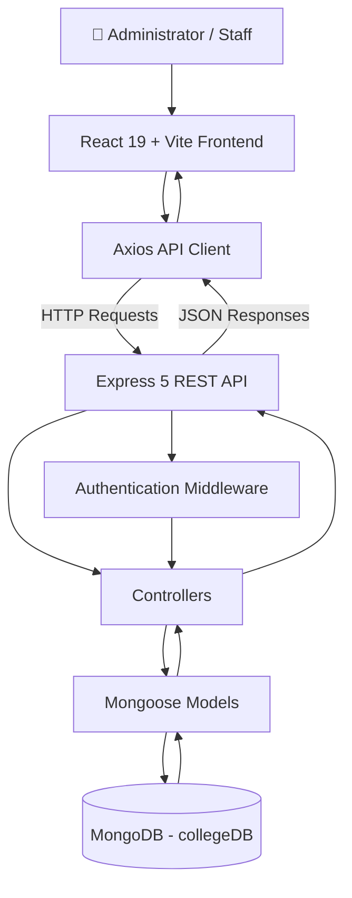

# 🎓 College Student Management System

<p align="center">
  
  
  
  
  
</p>

<p align="center">
  A modern, full-stack web application for managing college student records, monitoring academic statistics, and streamlining administrative operations.
</p>

<p align="center">
  <a href="https://github.com/KishanJangid5/MERN-STACK-College-Student-Management-System">Repository</a> ·
  <a href="#-features">Features</a> ·
  <a href="#-installation-and-setup">Installation</a> ·
  <a href="#-api-documentation">API Documentation</a>
</p>

---

## 📌 Overview

The **College Student Management System** is a full-stack web application built with the MERN stack: MongoDB, Express.js, React.js, and Node.js.

It provides a centralized interface for managing student information, viewing enrollment statistics, searching and filtering records, and performing administrative operations through RESTful APIs.

The application follows a client-server architecture, separating the React frontend from the Express backend and MongoDB database.

## ✨ Features

<table>
  <tr>
    <td width="50%">
      <h3>📊 Dashboard</h3>
      View student statistics, enrollment metrics, and course distribution.
    </td>
    <td width="50%">
      <h3>👨‍🎓 Student Management</h3>
      Create, view, update, and delete student records.
    </td>
  </tr>
  <tr>
    <td width="50%">
      <h3>🔎 Search & Filtering</h3>
      Find student records using supported search and filtering options.
    </td>
    <td width="50%">
      <h3>🔐 Authentication</h3>
      Register users, log in, retrieve profiles, and protect authorized operations.
    </td>
  </tr>
  <tr>
    <td width="50%">
      <h3>📈 Academic Insights</h3>
      Display student statistics and course distribution in the dashboard.
    </td>
    <td width="50%">
      <h3>🧩 Reusable UI Components</h3>
      Use modal dialogs, data tables, notification toasts, and shared interface components.
    </td>
  </tr>
</table>

## 🛠️ Technology Stack

| Technology | Purpose |
|---|---|
|  React 19 | Frontend UI and component-based development |
| Vite 8 | Frontend development server and build tooling |
| Axios | HTTP requests and centralized API communication |
| CSS | Responsive application styling and design system |
|  Node.js | Backend JavaScript runtime |
|  Express 5 | REST API and backend routing |
|  MongoDB | Document-oriented database |
| Mongoose 9 | Database schemas, models, validation, and queries |
| JSON Web Token (JWT) | Token-based authentication |
| Bcrypt | Password hashing |

## 🏗️ System Architecture

The application separates the user interface, backend API, and database into independent layers.



### Architecture Responsibilities

| Layer | Responsibility |
|---|---|
| Frontend | Renders the dashboard, student directory, forms, and authentication pages |
| API client | Centralizes HTTP communication with the backend |
| Express server | Handles API requests, routing, and middleware |
| Controllers | Implements authentication and student-management operations |
| Middleware | Handles JWT verification and application errors |
| Mongoose | Defines data models and interacts with MongoDB |
| MongoDB | Stores application records |

## 🧩 Main Application Modules

<table>
  <tr>
    <th>Module</th>
    <th>Purpose</th>
  </tr>
  <tr>
    <td><strong>Dashboard</strong></td>
    <td>Displays student statistics and course distribution.</td>
  </tr>
  <tr>
    <td><strong>Student Directory</strong></td>
    <td>Supports student record viewing, searching, filtering, and sorting.</td>
  </tr>
  <tr>
    <td><strong>Student Forms</strong></td>
    <td>Provides dialogs for adding and editing student information.</td>
  </tr>
  <tr>
    <td><strong>Student Details</strong></td>
    <td>Displays detailed information about an individual student.</td>
  </tr>
  <tr>
    <td><strong>Authentication</strong></td>
    <td>Supports registration, login, profile retrieval, and JWT-based authorization.</td>
  </tr>
  <tr>
    <td><strong>API Services</strong></td>
    <td>Centralizes frontend requests through Axios.</td>
  </tr>
</table>

## 📂 Project Structure

```text
FSD Project/
├── backend/
│   ├── config/
│   │   └── db.js
│   ├── controllers/
│   │   ├── authController.js
│   │   └── studentController.js
│   ├── middleware/
│   │   ├── authMiddleware.js
│   │   └── errorMiddleware.js
│   ├── models/
│   │   ├── Student.js
│   │   └── User.js
│   ├── routes/
│   │   ├── authRoutes.js
│   │   └── studentRoutes.js
│   ├── .env.example
│   ├── package.json
│   └── server.js
├── frontend/
│   ├── public/
│   ├── src/
│   │   ├── components/
│   │   │   ├── ConfirmModal.jsx
│   │   │   ├── CourseDistributionChart.jsx
│   │   │   ├── Icons.jsx
│   │   │   ├── Navbar.jsx
│   │   │   ├── StatsCards.jsx
│   │   │   ├── StudentDetailModal.jsx
│   │   │   ├── StudentFormModal.jsx
│   │   │   ├── StudentTable.jsx
│   │   │   └── Toast.jsx
│   │   ├── context/
│   │   │   └── AuthContext.jsx
│   │   ├── pages/
│   │   │   ├── Dashboard.jsx
│   │   │   ├── LoginPage.jsx
│   │   │   ├── RegisterPage.jsx
│   │   │   └── StudentsPage.jsx
│   │   ├── services/
│   │   │   └── api.js
│   │   ├── App.jsx
│   │   ├── App.css
│   │   ├── index.css
│   │   └── main.jsx
│   ├── .env.example
│   ├── index.html
│   ├── package.json
│   └── vite.config.js
├── .gitignore
└── README.md
```

## ⚙️ Installation and Setup

### Prerequisites

Ensure the following are installed:

- [Node.js](https://nodejs.org/)
- [MongoDB Community Server](https://www.mongodb.com/try/download/community) or a MongoDB Atlas database
- [Git](https://git-scm.com/)

### 1. Clone the Repository

```bash
git clone https://github.com/KishanJangid5/MERN-STACK-College-Student-Management-System.git
cd MERN-STACK-College-Student-Management-System
```

### 2. Configure the Backend

Navigate to the backend directory and install dependencies:

```bash
cd backend
npm install
```

Create a `.env` file inside `backend/` using `.env.example` as a reference.

```ini
PORT=5000
MONGODB_URI=mongodb://127.0.0.1:27017/collegeDB
JWT_SECRET=replace_with_a_secure_random_secret
JWT_EXPIRES_IN=7d
CLIENT_URL=http://localhost:5173
NODE_ENV=development
```

Ensure MongoDB is running and the connection string is correct.

### 3. Start the Backend Server

From the `backend/` directory:

```bash
npm run dev
```

Alternatively, if you need to start the server directly:

```bash
node server.js
```

| Service | URL |
|---|---|
| Backend API | `http://localhost:5000` |
| Health Check | `http://localhost:5000/api/health` |

### 4. Configure the Frontend

Open a second terminal at the repository root and run:

```bash
cd frontend
npm install
```

Create a `.env` file inside `frontend/`:

```ini
VITE_API_URL=http://localhost:5000/api
```

### 5. Start the Frontend

From the `frontend/` directory:

```bash
npm run dev
```

Open the application in your browser:

**http://localhost:5173**

Keep both the backend and frontend servers running while using the application.

## 🔌 API Documentation

**Base URL:** `http://localhost:5000/api`

### Authentication Endpoints

| Method | Endpoint | Description |
|---|---|---|
| `POST` | `/api/auth/register` | Register an administrator or staff user |
| `POST` | `/api/auth/login` | Authenticate a user and obtain a JWT |
| `GET` | `/api/auth/me` | Retrieve the authenticated user's profile |

### Student Management Endpoints

| Method | Endpoint | Description |
|---|---|---|
| `GET` | `/api/students/stats` | Retrieve student statistics and course distribution |
| `GET` | `/api/students` | Retrieve student records |
| `GET` | `/api/students/:id` | Retrieve a student by MongoDB ID |
| `POST` | `/api/students` | Create a student record |
| `PUT` | `/api/students/:id` | Update an existing student record |
| `DELETE` | `/api/students/:id` | Delete a student record |

### Search and Filtering

The student listing endpoint supports these query parameters:

| Parameter | Purpose |
|---|---|
| `search` | Search student records |
| `course` | Filter by course |
| `status` | Filter by student status |
| `sortBy` | Specify a supported sorting field |
| `order` | Specify sorting order |

Example request:

```http
GET /api/students?search=Kishan&course=Computer%20Science
```

**Authorization:** The create, update, and delete endpoints require a valid Bearer token according to the current project configuration. Check the backend routes for the precise access rules on read endpoints.

## 🧪 API Testing

You can test the backend using [Postman](https://www.postman.com/) or cURL.

### Check Server Health

```bash
curl http://localhost:5000/api/health
```

### Log In

```bash
curl -X POST http://localhost:5000/api/auth/login \
  -H "Content-Type: application/json" \
  -d "{\"email\":\"admin@college.edu\",\"password\":\"password123\"}"
```

Use the example credentials only if the demo administrator account has actually been configured in your application.

### Create a Student Record

Replace `<YOUR_JWT_TOKEN>` with a valid token obtained from the login endpoint.

```bash
curl -X POST http://localhost:5000/api/students \
  -H "Content-Type: application/json" \
  -H "Authorization: Bearer <YOUR_JWT_TOKEN>" \
  -d "{\"name\":\"Example Student\",\"email\":\"student@example.com\",\"course\":\"Computer Science\",\"age\":21,\"rollNumber\":\"CS-1004\",\"department\":\"Computer Science\",\"semester\":5,\"gpa\":8.4,\"status\":\"Active\"}"
```

Make sure the request fields match your Mongoose schema and validation rules.

## 🔐 Security and Configuration

- Keep actual `.env` files out of version control.
- Commit `.env.example` files with safe placeholder values only.
- Generate a strong, unique JWT secret for each environment.
- Store production secrets in your hosting provider's environment configuration.
- Use HTTPS and an appropriately restricted CORS configuration in production.
- Ensure protected operations enforce authentication and authorization.

**Important:** If a real secret has previously been committed to a public repository, replace or rotate it. Editing a file does not remove a secret from earlier Git commits.

## ☁️ Deployment Guide

### Frontend Deployment

The frontend can be deployed to a compatible hosting provider such as [Vercel](https://vercel.com/) or [Netlify](https://www.netlify.com/).

1. Install frontend dependencies with `npm install`.
2. Run `npm run build` from the `frontend/` directory.
3. Configure `VITE_API_URL` to point to your deployed backend API.
4. Configure the hosting provider to serve the generated `dist/` directory.

### Backend Deployment

The backend can be deployed to a compatible Node.js hosting provider such as [Render](https://render.com/) or [Railway](https://railway.com/).

Configure the following environment variables in your hosting dashboard:

| Variable | Description |
|---|---|
| `PORT` | Port supplied by the hosting platform |
| `MONGODB_URI` | Production MongoDB connection string |
| `JWT_SECRET` | Secure, randomly generated signing secret |
| `JWT_EXPIRES_IN` | JWT expiration duration |
| `CLIENT_URL` | Deployed frontend origin |
| `NODE_ENV` | Set to `production` |

Update the frontend API URL, configure production CORS settings, and verify the database connection before using the deployed application.

## 🔮 Potential Future Improvements

Possible enhancements for future versions include:

- Pagination for large student datasets.
- Role-based access control for administrators and staff.
- Exporting student records to CSV or PDF.
- Advanced academic reports and analytics.
- Automated unit and integration testing.
- Live deployment with a public demonstration URL.

These are potential improvements, not claims about currently implemented functionality.

## 👨‍💻 Author

<p align="center">
  <strong>Kishan Jangid</strong>
  <br/>
  Full-Stack Development | MERN Stack
  <br/><br/>
  <a href="https://github.com/KishanJangid5">
    
  </a>
  <br/><br/>
  <a href="https://github.com/KishanJangid5/MERN-STACK-College-Student-Management-System">
    
  </a>
</p>

---

<p align="center">
  Built with React, Express, Node.js, and MongoDB.
  <br/>
  <em>Organizing student information through a practical full-stack web application.</em>
</p>
