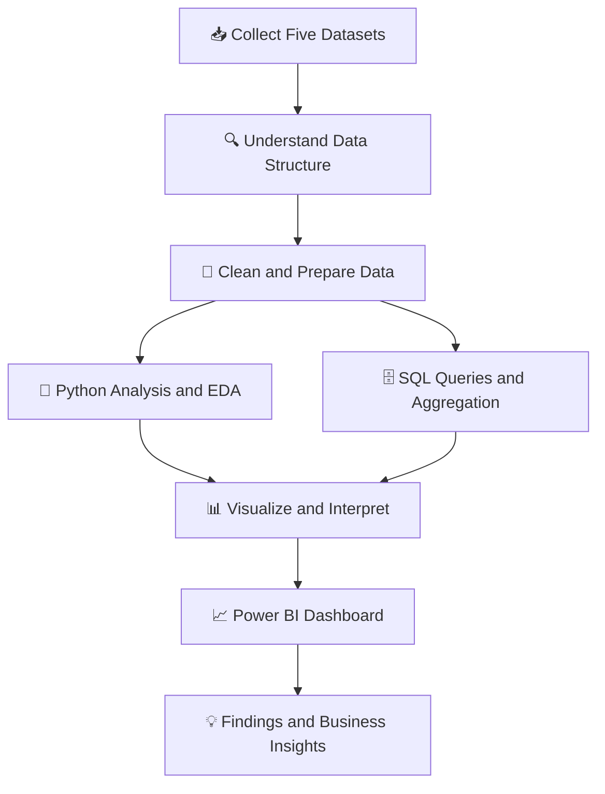

# 📊 Data Analytics Portfolio — Five Datasets Project

<p align="center">
  
  
  
  
</p>

<p align="center">
  <strong>Turning structured, unstructured, and semi-structured data into meaningful insights.</strong>
</p>

<p align="center">
  <a href="https://github.com/KishanJangid5">GitHub Profile</a> •
  <a href="https://github.com/KishanJangid5/Data-Analytics-5-Datasets-Project">Project Repository</a>
</p>

---

## 🚀 Project Overview

This project explores **five different datasets** to practice and demonstrate the end-to-end data analytics workflow: data understanding, cleaning, exploratory data analysis (EDA), SQL querying, visualization, and business insight generation.

The project combines Python-based analysis, SQL scripts, and Power BI dashboard development to examine customer reviews, ecommerce products, fashion images, consumer complaints, and clothing rental experiences.

The goal is to demonstrate practical data analytics skills through real-world-style datasets, reproducible analysis notebooks, structured SQL queries, and interactive business reporting.

## 🛠️ Technical Skills & Tools

<p align="center">
  
  
  
  
  
  
  
  
  
  
</p>

| Skill area | Skills demonstrated |
|---|---|
| **Programming** | Python, notebook-based analysis |
| **Data manipulation** | Pandas, NumPy, CSV processing |
| **Data analysis** | Data cleaning, EDA, descriptive statistics, aggregation |
| **Data visualization** | Matplotlib, Power BI reports and dashboards |
| **SQL** | Filtering, grouping, aggregations, joins and analytical queries where used |
| **Data formats** | CSV, JSON, compressed JSON, binary image datasets |
| **Business intelligence** | KPI reporting, category comparisons, sentiment and complaint analysis |
| **Version control** | Git, GitHub, `.gitignore`, commits and remote repository management |

> The repository contains Python notebooks and SQL scripts. The Power BI reports are maintained locally and are excluded from the GitHub upload.

## 📂 The Five Datasets

<table>
  <tr>
    <td width="50%" valign="top">

### 01 · 🛒 Amazon Product Reviews

**Data type:** Structured

**Focus:** Customer reviews and sentiment labels.

**Analysis includes:**
- Review data exploration
- Review-length analysis
- Positive and negative label distribution
- Summary statistics and visualizations

**Key finding:** Approximately 76.2% of the analyzed reviews have the positive label and 23.8% have the negative label.

</td>
    <td width="50%" valign="top">

### 02 · 👗 Ecommerce Products

**Data type:** Structured

**Focus:** Product categories, ratings, prices and product attributes.

**Analysis includes:**
- Category-wise product analysis
- Average rating comparisons
- Product data cleaning
- SQL-based analysis

**Key finding:** Category-level ratings help identify which product categories receive higher average customer ratings.

</td>
  </tr>
  <tr>
    <td width="50%" valign="top">

### 03 · 🧥 Fashion MNIST

**Data type:** Image-based / unstructured

**Focus:** Fashion images and their associated labels.

**Analysis includes:**
- Dataset and label exploration
- Image dataset inspection
- Label distribution analysis
- Data preparation and descriptive analysis

**Objective:** Understand the structure and characteristics of an image-based dataset.

</td>
    <td width="50%" valign="top">

### 04 · 🏦 Consumer Complaints

**Data type:** Structured text records

**Focus:** Consumer complaints, product categories, states and response information.

**Analysis includes:**
- Complaint category analysis
- State-wise complaint volume
- Timely response analysis
- Data cleaning and SQL queries

**Key finding:** Mortgage is the highest-volume complaint category in the analyzed data, with 242,194 complaints.

</td>
  </tr>
  <tr>
    <td colspan="2" valign="top">

### 05 · 👚 Rent the Runway

**Data type:** Semi-structured JSON

**Focus:** Clothing rental experiences, fit feedback and ratings.

**Analysis includes:**
- JSON data exploration
- Conversion and preparation for analysis
- Fit-related rating comparisons
- Python and SQL-based analysis

**Key finding:** Items marked as fitting well have an average rating of 9.31, compared with 8.55 for items marked large and 8.42 for items marked small.

</td>
  </tr>
</table>

## 📈 Key Project Results

<p align="center">
  
  
  
  
</p>

| Metric | Result | Dataset |
|---|---:|---|
| Positive review rate | 76.2% | Amazon Product Reviews |
| Negative review rate | 23.8% | Amazon Product Reviews |
| Timely response rate | 97.3% | Consumer Complaints |
| Average rental rating | 9.09 | Rent the Runway |
| Mortgage complaints | 242,194 | Consumer Complaints |
| Average rating — fits well | 9.31 | Rent the Runway |
| Average rating — large fit | 8.55 | Rent the Runway |
| Average rating — small fit | 8.42 | Rent the Runway |

*These are results from the current analysis. They describe the available datasets and are not necessarily representative of every customer, product or company.*

## 📊 Power BI Dashboard

The project includes a Power BI report titled:

**CUSTOMER, PRODUCT & EXPERIENCE INSIGHTS**

The report brings together high-level KPIs and visual comparisons across the analyzed datasets.

### Dashboard highlights

- KPI cards for review sentiment, timely complaint responses and rental ratings
- Top complaint category by complaint volume
- Top ecommerce categories by average rating
- Customer satisfaction comparisons by clothing fit
- Top states by consumer complaint volume
- Review sentiment distribution
- Dataset summary and key business insights

### Dashboard purpose

The dashboard is designed to help users explore customer feedback, product category ratings, complaint trends and rental experience patterns in one reporting view.

> **Power BI file availability:** The `.pbix` reports are excluded from this repository because of their size. They remain available in the local project folder.

## 🔄 Data Analytics Workflow



### Workflow explained

1. **Data collection:** Work with five datasets in CSV, JSON, and image-based formats.
2. **Data understanding:** Inspect columns, labels, data types, distributions and dataset structure.
3. **Data preparation:** Clean and prepare data for meaningful analysis.
4. **Python analysis:** Use notebooks to explore the datasets and calculate descriptive statistics.
5. **SQL analysis:** Store analytical queries in separate SQL files for querying and aggregation.
6. **Visualization:** Use charts and Power BI visuals to communicate patterns.
7. **Reporting:** Summarize key findings and their business relevance.

## 🗂️ Repository Structure

```text
Data-Analytics-5-Datasets-Project/
│
├── 01_Structured Files/
│   ├── Amazon Product Reviews/
│   └── Ecommerce Dataset (Products & Sizes Included)/
│
├── 02_UnStructered Files/
│   ├── Consumer Complaints Database/       [Excluded from Git]
│   └── Fashion MNIST/
│       ├── *.csv                          [Excluded from Git]
│       └── image binaries                 [Large files excluded]
│
├── 03_Semi Structured Files.csv/
│   ├── RentTheRunway_SQL.csv
│   └── renttherunway_final_data.json.gz   [Excluded from Git]
│
├── Analysis/
│   ├── 01_Amazon_Product_Reviews_Analysis.ipynb
│   ├── 02_Ecommerce_Analysis.ipynb.ipynb
│   ├── 03_Fashion_MNIST_Analysis.ipynb.ipynb
│   ├── 04_Consumer_Complaints_Analysis.ipynb.ipynb
│   ├── 05_RentTheRunway_Analysis.ipynb.ipynb
│   │
│   ├── SQL/
│   │   ├── 01_Amazon_Product_Reviews_Analysis.sql
│   │   ├── 02_Ecommerce_Analysis.sql
│   │   ├── 03_Fashion_MNIST_Analysis.sql
│   │   ├── 04_Consumer_Complaints_Analysis.sql
│   │   └── 05_RentTheRunway_Analysis.sql
│   │
│   ├── amazon_reviews_cleaned.csv
│   ├── ecommerce_cleaned.csv
│   └── Power BI/                           [Excluded from Git]
│
├── STRUCTURE AND INFO/
│   └── Project structure screenshots
│
├── .gitignore
└── README.md
```

*The diagram documents the intended local project organization. Only files tracked by Git are available in the online repository.*

## 💼 Business Insights

### 1. Customer sentiment
The Amazon review dataset contains a larger proportion of positive-labeled reviews than negative-labeled reviews. This provides a starting point for investigating customer feedback patterns.

### 2. Ecommerce category ratings
Comparing average ratings across product categories can help identify categories with relatively stronger customer ratings.

### 3. Complaint patterns
Mortgage is the largest complaint category in the current analysis. State-wise complaint counts provide geographic context for reported complaints.

### 4. Complaint response performance
The calculated timely response rate is 97.3%. This is a useful measure of response performance in the analyzed complaint records.

### 5. Clothing fit and rental ratings
The average rating is higher for items marked as fitting well than for items marked large or small. This highlights the potential value of fit-related feedback in customer experience analysis.

### Important interpretation note
Complaint volume is not the same as product demand. The current analysis does not establish sales volume, inventory supply, sales demand by location or causal relationships between these metrics.

## 🧰 Setup and Reproduce the Analysis

### Requirements

- Python 3.12 or a compatible Python environment
- Jupyter Notebook or JupyterLab
- Pandas and NumPy
- Matplotlib
- SQL Server and/or MySQL for the relevant SQL exercises
- Power BI Desktop to open the local `.pbix` report

### Install Python packages

```bash
python -m pip install pandas numpy matplotlib jupyterlab
```

If a notebook requires additional libraries, install the dependencies it imports.

### Run the notebooks

1. Clone the repository.
2. Open a terminal in the project folder.
3. Launch JupyterLab:

```bash
python -m jupyterlab
```

4. Open the `Analysis` folder.
5. Open the notebook for the dataset you want to explore.
6. Check the dataset paths in the notebook before running the cells.

**Note:** Some original and cleaned datasets are excluded from Git. Download or restore the appropriate source files before running notebooks that depend on them. SQL scripts may also require table creation and data import before execution.

## 🔐 Dataset Availability and File Management

Large files are intentionally excluded using `.gitignore` to keep the repository manageable.

Excluded files include:
- The original Consumer Complaints dataset
- Large Fashion MNIST CSV and image files
- The cleaned Consumer Complaints and Fashion MNIST datasets
- Power BI `.pbix` reports
- The compressed Rent the Runway JSON source file

Some smaller datasets and prepared CSV files are included in the repository. Availability depends on the files committed to Git.

Please check each dataset's original license and redistribution terms before sharing copies publicly.

## 🎯 Learning Outcomes

Through this project, I have practiced:

- Working with different data structures and file formats
- Inspecting and preparing datasets for analysis
- Performing exploratory data analysis using Python
- Writing and organizing SQL analytical queries
- Comparing categories, labels, ratings and complaint patterns
- Designing KPI-focused Power BI reports
- Translating analytical findings into clear business insights
- Managing project files with Git and GitHub
- Documenting an analytics workflow for reproducibility

## 🚀 Future Improvements

- Add dashboard screenshots to the repository
- Document data sources and licenses
- Add reproducible setup instructions and dependency files
- Improve automated data-quality checks
- Add more detailed SQL query explanations
- Extend dashboard interactivity and drill-through analysis
- Explore product demand and supply only when suitable sales, inventory and location data are available

## 👨‍💻 About the Project

This is a hands-on data analytics portfolio project focused on Python, SQL, data exploration, visualization and Power BI reporting.

**Author:** Kishan Jangid

<p align="center">
  <a href="https://github.com/KishanJangid5">
    
  </a>
  <a href="https://github.com/KishanJangid5/Data-Analytics-5-Datasets-Project">
    
  </a>
</p>

---

<p align="center">
  <em>Learn from data. Discover patterns. Communicate insights.</em>
</p>